<!-- every picture here is drawn by scripts/draw.mjs; edit that, then run npm run draw -->

<a href="https://ebenezermerd.me"><picture><source media="(prefers-color-scheme: dark)" srcset="assets/header-dark.svg"></picture></a>

  <a href="https://ebenezermerd.me"><picture><source media="(prefers-color-scheme: dark)" srcset="assets/button-portfolio-dark.svg"></picture></a>
  <a href="https://linkedin.com/in/ebenezer-merdekiyos-a81519213"><picture><source media="(prefers-color-scheme: dark)" srcset="assets/button-linkedin-dark.svg"></picture></a>
  <a href="mailto:ebenezermerd@gmail.com"><picture><source media="(prefers-color-scheme: dark)" srcset="assets/button-email-dark.svg"></picture></a>
  <a href="https://twitter.com/ebenezermerd"><picture><source media="(prefers-color-scheme: dark)" srcset="assets/button-twitter-dark.svg"></picture></a>

<picture><source media="(prefers-color-scheme: dark)" srcset="assets/heading-street-dark.svg"></picture>

  <a href="https://zelalemclinic.com"><picture><source media="(prefers-color-scheme: dark)" srcset="assets/card-clinic-dark.svg"></picture></a>
  <a href="https://t.me/jemawsbot"><picture><source media="(prefers-color-scheme: dark)" srcset="assets/card-jemaw-dark.svg"></picture></a>
  <a href="https://osteodata.net"><picture><source media="(prefers-color-scheme: dark)" srcset="assets/card-osteodata-dark.svg"></picture></a>
  <a href="https://pranalyzer.vercel.app"><picture><source media="(prefers-color-scheme: dark)" srcset="assets/card-issuefinder-dark.svg"></picture></a>
  <a href="https://lumenglass.vercel.app"><picture><source media="(prefers-color-scheme: dark)" srcset="assets/card-kits-dark.svg"></picture></a>
  <a href="https://groveforest.vercel.app"><picture><source media="(prefers-color-scheme: dark)" srcset="assets/card-grove-dark.svg"></picture></a>

Fourteen more stand in the sketched town at <a href="https://ebenezermerd.me">ebenezermerd.me</a>, with <a href="https://softlyneum.vercel.app">Softly</a> and <a href="https://plainminimal.vercel.app">Plain</a> next door to Lumen.

<picture><source media="(prefers-color-scheme: dark)" srcset="assets/heading-town-dark.svg"></picture>

<picture><source media="(prefers-color-scheme: dark)" srcset="assets/town-dark.svg"></picture>

<picture><source media="(prefers-color-scheme: dark)" srcset="assets/heading-toolbox-dark.svg"></picture>

<picture><source media="(prefers-color-scheme: dark)" srcset="assets/toolbox-dark.svg"></picture>

<picture><source media="(prefers-color-scheme: dark)" srcset="assets/heading-process-dark.svg"></picture>

<picture><source media="(prefers-color-scheme: dark)" srcset="assets/process-dark.svg"></picture>

<b>Kind words from people I have worked with</b>

 

> I collaborated with Abenezer during his internship at AASTU. He consistently met milestones, demonstrated strong ownership, and incorporated feedback effectively, with reliable delivery throughout.
>
> <b>Mr. Gemechu, Senior Developer, AASTU</b>

> On an Upwork engagement, Abenezer delivered the required landing page frontend, pixel accurate, performant, and on schedule. Collaboration was smooth and professional.
>
> <b>Mr. Amanuel, Developer, ChromaWay</b>

> During his internship with the university IT directorate, Abenezer carried out tasks professionally, communicated clearly, and delivered dependable outcomes.
>
> <b>Mr. Adem, IT Director, University</b>

> Abenezer delivered a complete clinic management system tailored to our operations, with organized implementation, reliable performance, and an interface intuitive for staff.
>
> <b>Dr. Zelalem, Client</b>

<a href="mailto:ebenezermerd@gmail.com"><picture><source media="(prefers-color-scheme: dark)" srcset="assets/footer-dark.svg"></picture></a>

Drawn by hand, by code: <a href="scripts/draw.mjs">scripts/draw.mjs</a> with rough.js, Caveat and Patrick Hand.

